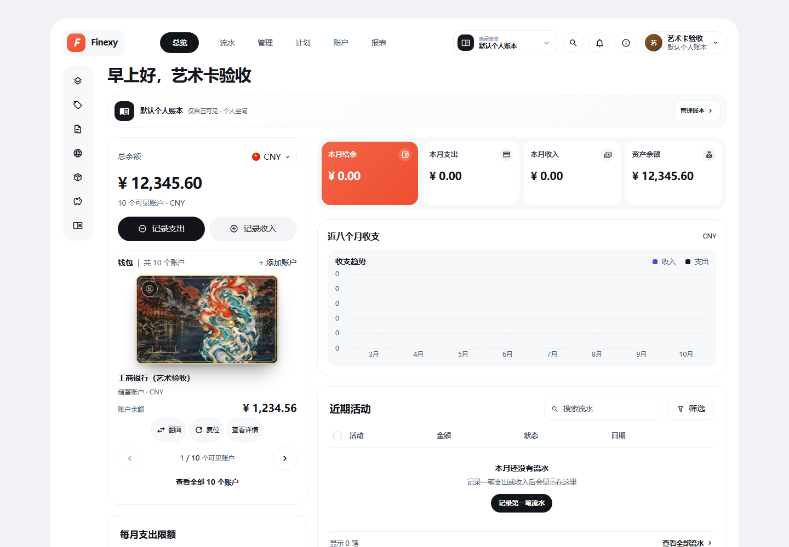
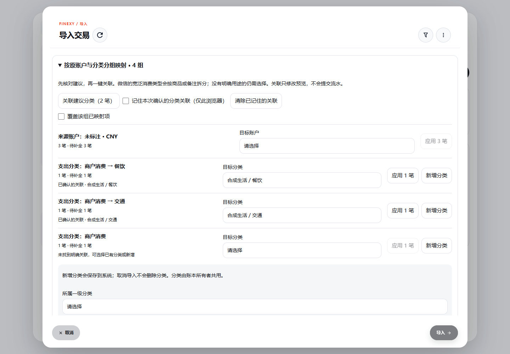
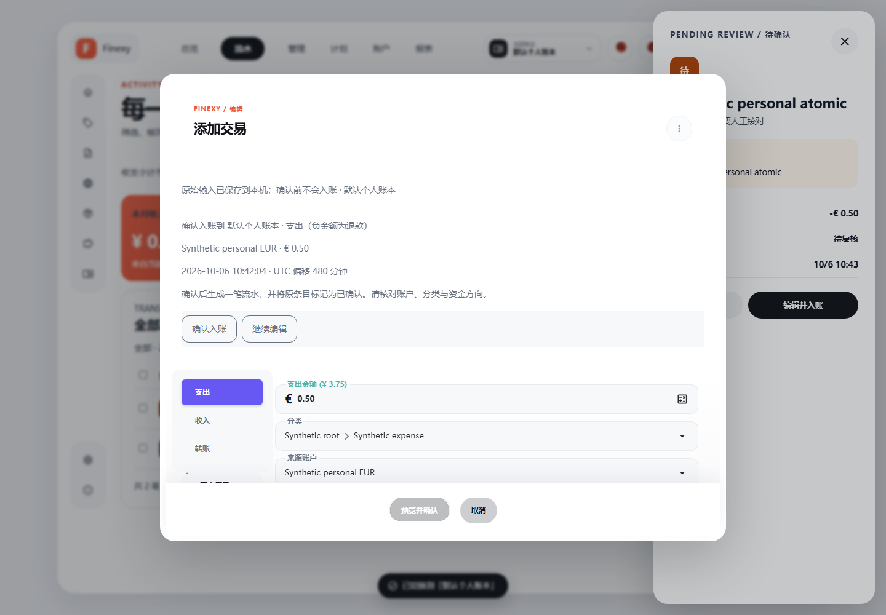
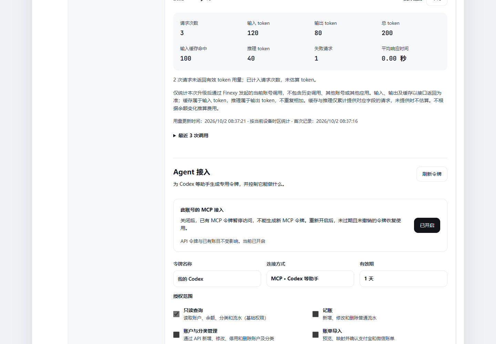
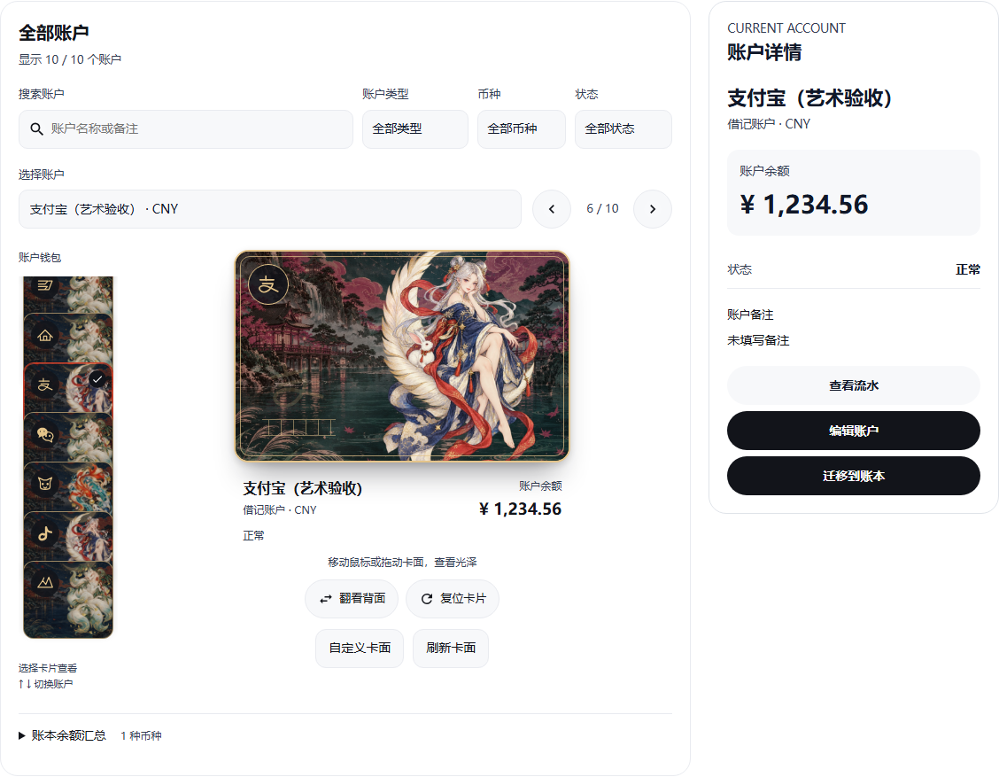
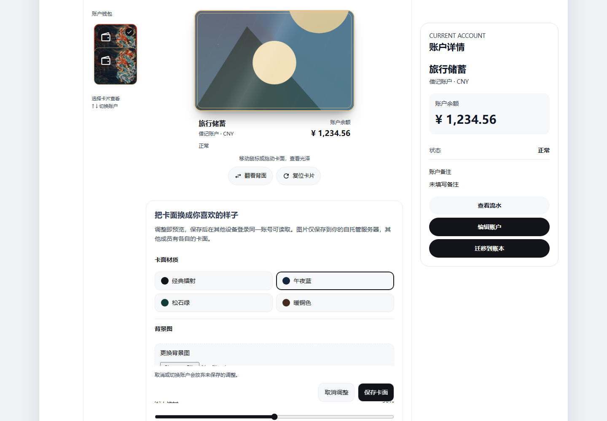
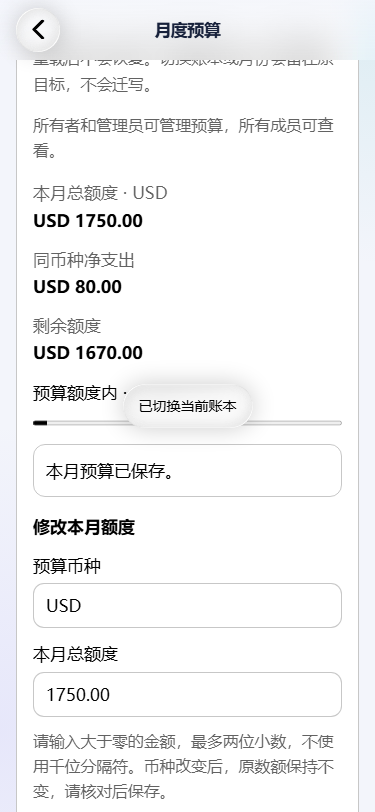
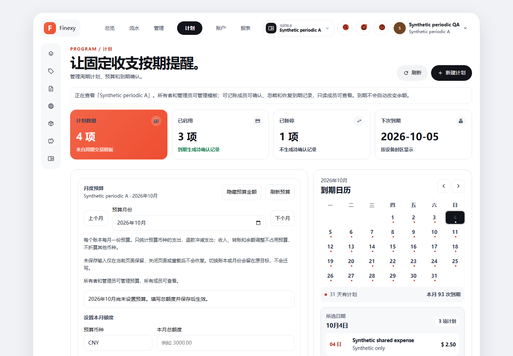

# Finexy 更新分享：支付宝微信账单导入、AI 票据识别、可控的助手授权，还有新的账户卡片

最近持续更新了我的开源记账项目 **Finexy**。从 1.9.0 到现在，主要围绕几件日常会遇到的事做改进：把支付账单整理进账本、用 AI 减少录入、和家人共同记账，以及让账户和预算更容易查看。

Finexy 支持 Web/PWA、Windows 和原生 Android，也可以部署在自己的 NAS 或服务器上。基础记账不要求配置 AI；需要识别文字和票据时，再接入自己的模型服务。

> 本文整理于 2026-10-10：正式发布版为 **1.9.3**，同时展示后续开发预览。文中截图来自隔离测试环境，账户、金额和流水均为示例数据。开发预览不代表下载当前 Release 就能获得全部新界面；各端功能也有差异。

*桌面 Web 开发预览：当前账本总览、账户钱包与近期流水。*

## 1. 支付宝和微信账单，可以批量整理进当前账本

逐笔补录历史消费很费时间，现在可以直接导入支付账单：

- 支付宝支持 ZIP/CSV，微信支持 XLSX/CSV。
- 加密 ZIP 在浏览器或设备内解密，解压密码不会上传到服务器。
- 导入前先预览，核对目标账户、分类与需要导入的记录，并检查重复。
- Web 导入绑定打开时选中的账本，个人和共享账本均按权限处理。

账单导入在 **1.9.2** 加入，**1.9.3** 进一步完善了当前账本导入和分组映射。

后续开发还补充了分类关联建议：例如微信账单里的“商户消费”，可以根据明确用途分别关联餐饮或交通；没有明确依据的项目仍留给你选择。缺少分类时，可按权限在导入页面新增，也可选择在当前浏览器记住已经确认的关联，方便下次使用。

*开发预览：按来源和用途分组关联；选择分类后仍需确认导入。*

## 2. AI 识别票据，结果先由你复核

**1.9.1** 完善了图片识别入口：Web 可以选择、拖放或粘贴图片；Android 可以从相册选择或拍照，将票据发送给已经配置的视觉模型。MCP 也增加了票据图片识别工具。

识别结果会作为建议，供你核对账户、分类、金额和备注，**确认后才入账**。

最新 Web 开发预览把来源录入和复核流程进一步串起来：文字、手动粘贴与图片进入统一来源页，图片可以裁剪、旋转并查看实际预览。读取剪贴板只是填入来源，发送给模型需要你明确操作。

这套流程分别提供“发送识别”“保存待复核”“确认入账”，并保留本机草稿与结果恢复。未匹配的账户和分类需要选择，结果未知时重试原请求；已经确认成功但刷新失败时，只重新读取结果。

*桌面 Web 开发预览：确认页列出目标账本、金额和资金方向；截图使用合成退款数据。移动 Web 的来源与复核流程也已完成相关隔离专项，Android 新账本 AI 页面仍在接续。*

## 3. 让助手帮忙记账，也能限定它的权限

**1.9.3** 加入了专用 Agent 授权。通过 API 或 MCP 接入的助手，可以按授权查询账目、记账或协助导入账单。

你可以为不同助手生成独立令牌，设置有效期，绑定一个指定账本，并分别选择只读查询、记账、账户与分类管理、账单导入权限。默认只读，需要写入时再明确授权；不再使用的令牌可以撤销，也可以关闭当前账号的 MCP 接入。

网页切换到另一个账本，不会扩大助手原有的授权。共享成员的权限变化，同样会影响后续请求。

*后续 Web 界面中的授权面板；截图未展示完整令牌或登录密码。*

后续 Web 还增加了独立的 **AI 设置**，集中查看模型配置和当前用户的今日、本月、累计调用用量，包括 token、失败次数与响应耗时。接口没有提供用量时会标记未计量；用量记录不保存提示词、响应内容或密钥。使用 DeepSeek 官方服务时，服务器所有者还可以查询 API 账户余额。

## 4. 账户卡片换了新样子，还能自己设计

桌面 Web 的账户展示做了一轮重绘：艺术卡面、随视角变化的光泽、翻面和钱包式叠放，让不同账户更容易辨认。账户名称、币种、真实余额和状态仍以清晰文字展示。

账户较多时，可以按名称或备注搜索，再按类型、币种和隐藏状态筛选；键盘也能切换账户。资产余额、待还款与溢缴款分别说明，不同币种分别汇总。

*桌面 Web 后续开发界面：选中账户后，卡片与右侧详情同步更新。*

还可以上传自己的背景和透明主体图，调整位置、缩放、材质、光泽与景深。点击保存后，在另一设备的桌面 Web 登录同一账号并读取相同账户，即可获取保存的卡面。共享账本成员可以有各自的个人卡面，这些外观设置不会改变账户余额或流水。

*桌面 Web 卡面编辑器；移动 Web 和原生 Android 尚未提供同样的编辑入口。*

这些卡片和部分界面增强已有指定 NAS 的历史部署验证，后续统一正式发布仍按发布计划推进。

## 5. 预算和固定收支，进一步围绕当前账本管理

新一轮开发把月度预算明确绑定到 **账本、月份和币种**。个人生活、家庭开支、旅行计划可以分别设置额度，查看同币种净支出和剩余额度；退款冲减支出，收入、转账和余额调整不占用预算。

所有成员可以查看，所有者和管理员可以管理预算。桌面 Web、移动 Web 和 Android 已完成相关实现与隔离专项。

*移动 Web 开发预览：示例美元预算，按预算币种统计支出。*

周期计划原本已有“到期待确认”的机制，这轮进一步接通当前账本范围：房租、订阅、固定收入等可以按周期提醒，到期先产生待确认记录，确认后才改变余额。你可以忽略或恢复待确认记录；隐藏计划和暂停计划分别处理。

*桌面 Web 开发预览：计划状态、到期日历与当前账本权限说明。预算和周期增强尚不能视为已包含在所有正式客户端中。*

## 6. 手机端也在补齐日常操作与恢复能力

移动 Web 后续开发已补齐当前账本的收支、账户间及外部转账、编辑、复制和单笔删除，并按成员角色限制操作。

普通记账、模板创建和 Web AI 确认等流程也逐步加入持久恢复：提交前保存原请求，遇到断网、页面重载或回包丢失时，继续核对同一次操作。Android 周期动作和模板创建已有相关新进程恢复验证。

目前 Android 新账本 AI 的 API 专项已通过，持久恢复与生产页面仍在开发；统一报告、完整导出和月度首页改版也在后续计划中。

## 版本怎么选

| 范围 | 主要内容 |
| --- | --- |
| 1.9.0 | 以账本为中心，个人/共享账本、邀请成员与快速切换 |
| 1.9.1 | Web、Android 与 MCP 的票据图片识别 |
| 1.9.2 | 支付宝/微信账单导入、登录体验与版本提醒 |
| 1.9.3 | Agent 分项授权、指定账本、MCP 开关及当前账本导入 |
| 后续开发预览 | 艺术卡片与自定义、分类建议、AI 设置、账本预算、周期与模板恢复、Web AI 来源和原子确认；部分已有指定部署，其余仍待正式发布 |

Android 客户端使用独立版本号，不能直接用服务端的 1.9.3 判断原生 App 已具备哪些新功能。正式包的内容请以对应 Release 说明为准。

## 项目与下载

如果你需要把个人和家庭账目分开管理，希望数据保存在自己的 NAS 或服务器上，或者想让助手在明确授权下协助整理账单，可以关注 Finexy。

- [GitHub 项目与部署说明](https://github.com/SMTM-PH/finexy-ai-bookkeeping)
- [正式版本下载与更新说明](https://github.com/SMTM-PH/finexy-ai-bookkeeping/releases)
- [问题反馈与功能建议](https://github.com/SMTM-PH/finexy-ai-bookkeeping/issues)

欢迎反馈实际使用中遇到的问题，尤其是支付账单格式、多人记账流程和手机端体验。如果项目对你有帮助，也欢迎点个 Star。
